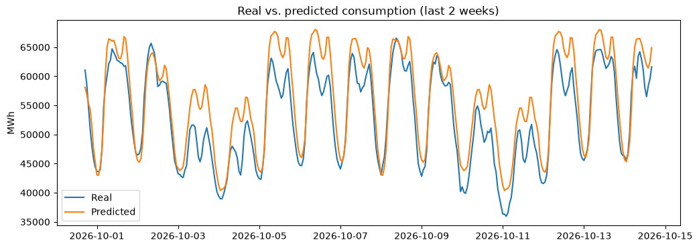

# Energy Consumption Forecast ⚡

Forecasting Germany's hourly electricity consumption with machine learning.

## Data
Hourly electricity consumption (Netzlast) for Germany from [SMARD](https://www.smard.de) (Bundesnetzagentur), last 12 months.

## Approach
1. Loaded the data via the SMARD API and explored it with pandas
2. Created time features: hour, weekday, month
3. Time-based split: first 80% for training, last 20% for testing
4. Trained a Random Forest Regressor (scikit-learn)

## Results
- MAE: 2601 MWh
- MAPE: 5.3 %

The model captures the daily rhythm and weekend dips well, but tends to slightly overestimate consumption.

## Next steps
- Add weather data (temperature)
- Add public holidays
- Add lag features (consumption of previous day)

## Tech
Python, pandas, NumPy, scikit-learn, Matplotlib, Jupyter

## Run it
pip install -r requirements.txt
jupyter notebook